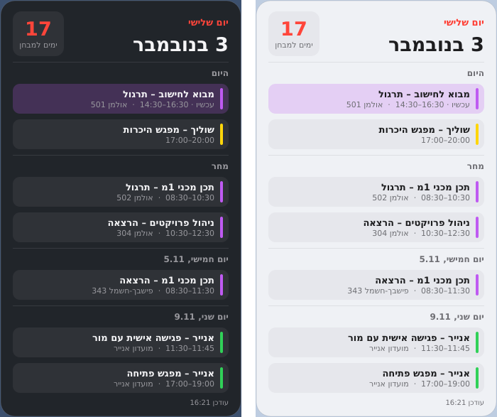

# ווידג'ט יומן לשולחן העבודה

> `config.json` (עם הכתובות הסודיות) לא נשמר בגיט: הוא מופיע ב-`.gitignore`. בריפו נמצאת רק התבנית `config.example.json`.

ווידג'ט בסגנון macOS שמציג על שולחן העבודה את יומני Google שלך בצבעים, עם ספירה לאחור למבחן הקרוב.
הוא לקריאה בלבד: עורכים באייפון, והווידג'ט מתעדכן לבד כל 5 דקות.

## התקנה (פעם אחת, בערך 10 דקות)

### 1. התקנת Python
מורידים מ-python.org ← Downloads ← Windows. בהתקנה **מסמנים את "Add python.exe to PATH"**, ואז Install Now.

### 2. מחלצים את התיקייה
מחלצים את קובץ ה-zip לתיקייה קבועה, למשל `C:\Users\<שם>\CalendarWidget`.
אחרי ההתקנה לא מזיזים את התיקייה, כי ההפעלה האוטומטית מצביעה עליה.

### 3. מעתיקים את הכתובות הסודיות מ-Google
לכל יומן:
1. נכנסים ל-calendar.google.com במחשב ← ⚙️ הגדרות.
2. בצד שמאל, תחת "הגדרות של היומנים שלי", לוחצים על שם היומן.
3. גוללים ל**"כתובת סודית בפורמט iCal"** ומעתיקים אותה. היא מתחילה ב-`https://calendar.google.com/calendar/ical/...` ונגמרת ב-`basic.ics`.
4. בהפעלה הראשונה נוצר `config.json` מתוך `config.example.json`. פותחים את `config.json` ב-Notepad ומדביקים את הכתובת במקום `PASTE_SECRET_ICAL_URL_HERE` של היומן המתאים.

> ⚠️ **אל תשתף את הכתובות האלה.** כל מי שיש לו את הכתובת יכול לראות את היומן.
> אם כתובת דלפה, אפשר לאפס אותה באותו מקום בהגדרות.

יומן שלא רוצים להציג פשוט מוחקים מהרשימה, או משאירים בלי כתובת.

### 4. הפעלה
לוחצים פעמיים על **`install.bat`**. הסקריפט מתקין את החבילות, מוסיף את הווידג'ט להפעלה האוטומטית של Windows ומפעיל אותו.

## שימוש
- **גרירה עם העכבר** מזיזה את הווידג'ט, והמיקום נשמר.
- **קליק ימני** פותח תפריט: רענן עכשיו / פתח הגדרות / יציאה.
- אחרי שינוי ב-`config.json` יוצאים מהווידג'ט ומפעילים מחדש עם `start_widget.bat`.

## הגדרות ב-config.json
| שדה | מה זה עושה |
|---|---|
| `theme` | `"dark"` או `"light"` |
| `color` | צבע היומן, בקוד HEX. הצבעים של macOS: כחול `#0A84FF`, סגול `#BF5AF2`, אדום `#FF453A`, ירוק `#30D158`, צהוב `#FFD60A`, כתום `#FF9F0A`, ורוד `#FF375F` |
| `exams` | `true` ביומן המבחנים, כדי שתוצג ספירה לאחור למבחן הקרוב |
| `days_ahead` | כמה ימים קדימה להציג (ברירת מחדל 7) |
| `max_events` | מספר האירועים המקסימלי שמוצגים |
| `width` | רוחב הווידג'ט בפיקסלים |
| `refresh_minutes` | כל כמה דקות לרענן |
| `always_on_top` | `true` אם רוצים שהווידג'ט יהיה מעל החלונות ולא מתחתם |

## הערות
- כתובות iCal של Google מתעדכנות אצל Google עצמה בהשהיה של כמה דקות, ולפעמים יותר. לכן שינוי שעשית באייפון יכול לקחת קצת זמן עד שיופיע בווידג'ט.
- כשאין אינטרנט, הווידג'ט מציג את הנתונים האחרונים שנשמרו ומסמן ⚠ בתחתית.
- כדי להסיר את הווידג'ט מההפעלה האוטומטית מריצים `remove_from_startup.bat`.
